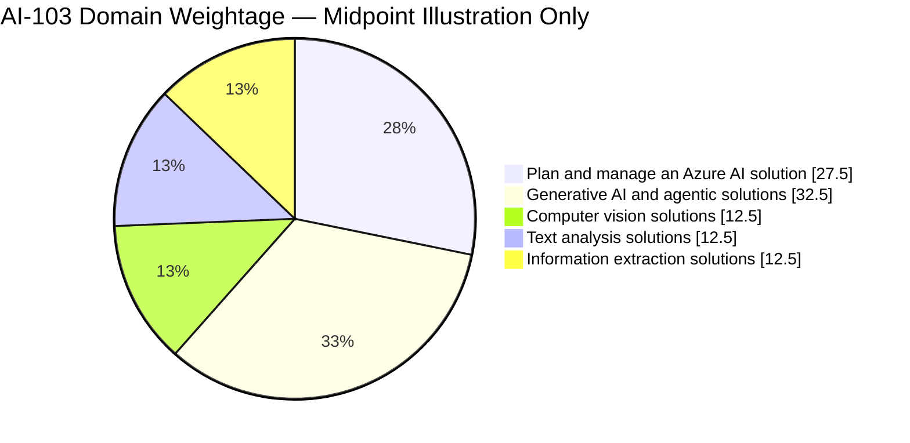
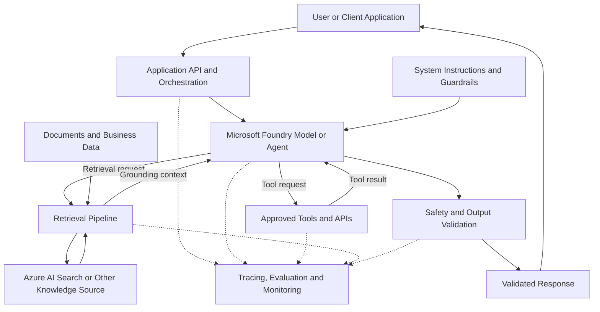
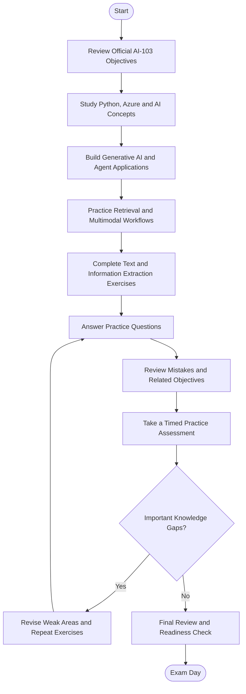
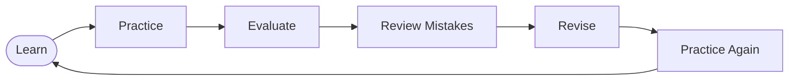
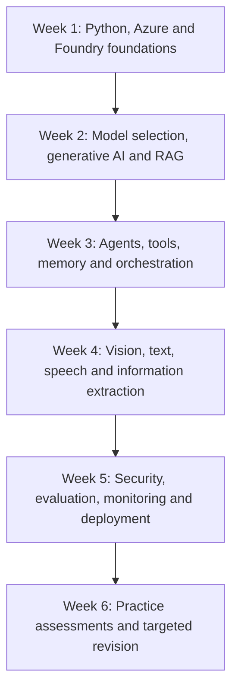
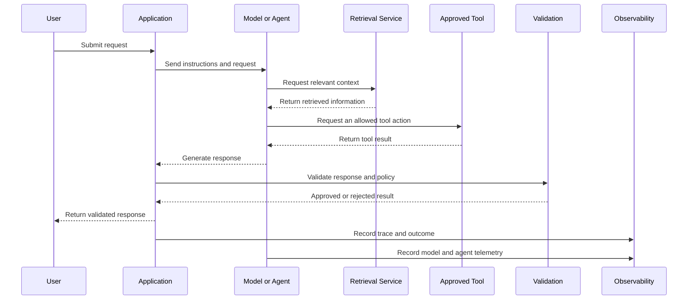

# Microsoft AI-103: Azure AI Apps and Agents Developer Study Guide

A practical, community-driven study guide for preparing for **Microsoft AI-103: Developing AI Apps and Agents on Azure**. This repository organizes the official exam objectives into learning areas, architecture diagrams, hands-on projects, original practice questions, and a structured revision roadmap.

The focus is on building and operating AI applications—not just learning AI terminology. Topics include Microsoft Foundry, generative AI, AI agents, retrieval-augmented generation (RAG), computer vision, text and speech analysis, information extraction, evaluation, security, and responsible AI.

Use this guide alongside the [official Microsoft AI-103 study guide](https://learn.microsoft.com/en-us/credentials/certifications/resources/study-guides/AI-103), Microsoft Learn, and the relevant Azure documentation.

---

## Table of Contents

- [About AI-103](#about-ai-103)
- [Who Should Prepare?](#who-should-prepare)
- [Exam Information](#exam-information)
- [Official Exam Objectives](#official-exam-objectives)
- [Exam Domain Weightage](#exam-domain-weightage)
- [AI Application and Agent Architecture](#ai-application-and-agent-architecture)
- [How to Prepare for AI-103](#how-to-prepare-for-ai-103)
- [Certification Preparation Flowchart](#certification-preparation-flowchart)
- [Circular Study and Revision Cycle](#circular-study-and-revision-cycle)
- [Suggested Six-Week Study Roadmap](#suggested-six-week-study-roadmap)
- [AI Agent Execution Sequence](#ai-agent-execution-sequence)
- [Hands-On Projects](#hands-on-projects)
- [AI-103 Practice Questions](#ai-103-practice-questions)
- [Common Preparation Mistakes](#common-preparation-mistakes)
- [Career Relevance](#career-relevance)
- [Frequently Asked Questions](#frequently-asked-questions)
- [Official and Additional Learning Resources](#official-and-additional-learning-resources)
- [About CertsGate](#about-certsgate)

---

## About AI-103

**AI-103** is the exam associated with **Microsoft Certified: Azure AI Apps and Agents Developer Associate**. It focuses on developing, managing, and deploying AI applications and agent-based solutions using Microsoft Foundry and related Azure services.

The exam's skills measured extend beyond calling a model API. Candidates should understand how to choose models and services, connect applications to relevant data, build agents with tools, evaluate output quality, implement multimodal workflows, and operate AI solutions securely.

The official study guide identifies five main skill areas:

- Planning and managing an Azure AI solution.
- Implementing generative AI and agentic solutions.
- Implementing computer vision solutions.
- Implementing text analysis solutions.
- Implementing information extraction solutions.

Official links:

- [AI-103 exam and certification page](https://learn.microsoft.com/en-us/credentials/certifications/exams/ai-103/)
- [Official AI-103 study guide](https://learn.microsoft.com/en-us/credentials/certifications/resources/study-guides/AI-103)

## Who Should Prepare?

AI-103 is intended for developers and AI engineers who build and maintain AI-powered applications on Azure.

This guide is useful for:

- Python developers moving into AI application development.
- Software engineers integrating generative AI into applications.
- Developers building AI agents and tool-using workflows.
- AI engineers working with retrieval, grounding, and multimodal data.
- Technical professionals responsible for evaluating, securing, and monitoring AI applications.

Microsoft recommends experience developing applications with Python and familiarity with general AI, generative AI, and Azure services. Knowledge of APIs, SDKs, data handling, and application development will make the material easier to apply.

If you need a foundation first, begin with Microsoft's [Get started with AI applications and agents on Azure learning path](https://learn.microsoft.com/en-us/training/paths/get-started-with-artificial-intelligence-on-azure/).

---

## Exam Information

| Item | Details |
|---|---|
| Exam code | AI-103 |
| Official exam title | Developing AI Apps and Agents on Azure |
| Certification | Microsoft Certified: Azure AI Apps and Agents Developer Associate |
| Level | Intermediate |
| Role | AI Engineer Developer |
| Main platform | Microsoft Foundry and related Azure AI services |
| Skills-measured version referenced here | April 16, 2026 |
| Exam duration | 120 minutes, according to the official exam page |
| Passing score | 700 or greater on Microsoft's 1–1000 scale |
| Question count | Not specified here; confirm current exam information |
| Exam experience | Proctored; interactive components may be included |

Exam policies, language availability, timing, and question formats can change. Verify the latest information on the [official AI-103 page](https://learn.microsoft.com/en-us/credentials/certifications/exams/ai-103/) before booking.

---

## Official Exam Objectives

Microsoft's study guide organizes AI-103 into five domains. The following sections summarize their focus; the official study guide remains the authoritative source for detailed tasks.

### 1. Plan and Manage an Azure AI Solution — 25–30%

This domain covers the decisions and operational controls needed to build AI applications and agent solutions on Azure.

Key areas include:

- Selecting appropriate models, including large language models (LLMs), small language models, multimodal models, and Foundry Tools.
- Selecting services for generation, grounding, vector search, agent workflows, and multimodal processing.
- Choosing retrieval and indexing approaches.
- Selecting memory, tool, and knowledge-integration services.
- Designing infrastructure and deployment approaches for AI apps and agents.
- Configuring model and agent deployments.
- Integrating Foundry projects with CI/CD pipelines.
- Managing quotas, scaling, rate limits, and cost.
- Monitoring performance, drift, safety events, grounding quality, and search-index health.
- Configuring managed identities, private networking, keyless credentials, and role policies.
- Applying safety filters, evaluations, auditing, provenance, approval workflows, and tool-access controls.

**Practice objective:** Given an application's requirements, justify the model, retrieval approach, deployment configuration, security controls, monitoring, and cost-management strategy.

### 2. Implement Generative AI and Agentic Solutions — 30–35%

This is the largest published exam domain by percentage range.

Key areas include:

- Deploying and consuming language, code, and multimodal models.
- Building retrieval-augmented generation (RAG) applications.
- Designing workflows, tool-augmented flows, and multistep processing pipelines.
- Evaluating output quality, relevance, safety, and fabricated responses.
- Connecting applications to Foundry projects through SDKs and connectors.
- Defining agent roles, goals, conversation tracking, and tool schemas.
- Building agents with retrieval, function calling, and conversation memory.
- Integrating APIs, knowledge stores, search, content understanding, and custom functions.
- Orchestrating multiple agents and workflows.
- Implementing autonomous or semiautonomous processes with safeguards and approval controls.
- Monitoring agent behavior and investigating errors.
- Tuning prompts and generation parameters.
- Implementing observability, tracing, token analytics, and latency analysis.

**Practice objective:** Build a small agent that retrieves relevant information, invokes an approved tool, and produces an answer that can be evaluated and traced.

### 3. Implement Computer Vision Solutions — 10–15%

This domain covers generating, analyzing, and safely handling visual content.

Key areas include:

- Generating images from text prompts and reference media.
- Generating and editing video.
- Implementing image editing with inpainting, masks, and prompt-driven changes.
- Analyzing images and videos with multimodal models.
- Producing captions, alt text, and detailed image descriptions.
- Answering questions grounded in visual evidence.
- Using Azure Content Understanding to extract visual characteristics.
- Identifying objects, components, or regions in visual data.
- Processing video segments.
- Detecting unsafe visual content and indirect prompt injection embedded in images.
- Applying visual policy controls, including watermarking and content review.

**Practice objective:** Design a visual analysis workflow that extracts useful information while validating the result against the input and applying appropriate safety checks.

### 4. Implement Text Analysis Solutions — 10–15%

This domain includes language processing, structured output, translation, and speech-based interactions.

Key areas include:

- Extracting entities, topics, summaries, and structured JSON.
- Detecting sentiment, tone, safety concerns, and sensitive content.
- Building translation workflows with Azure Translator or language models.
- Customizing text-analysis behavior for domain-specific tasks.
- Converting speech to text and text to speech.
- Integrating speech into agent interactions.
- Working with custom speech models.
- Enabling reasoning over audio inputs.
- Translating speech into other languages.

**Practice objective:** Build a text or speech workflow that converts input into structured output and checks whether the result satisfies the application's requirements.

### 5. Implement Information Extraction Solutions — 10–15%

This domain focuses on turning documents and other content into searchable, structured, grounded information.

Key areas include:

- Ingesting and indexing documents, images, audio, and video.
- Configuring semantic, hybrid, and vector search.
- Enriching content with built-in or custom skills.
- Building RAG ingestion pipelines that include document processing and OCR.
- Connecting retrieval pipelines to agents and workflows.
- Combining OCR, layout analysis, and field extraction.
- Using Content Understanding to create grounded representations for RAG and agents.
- Generating structured or Markdown outputs for downstream reasoning.

**Practice objective:** Create a pipeline that ingests documents, extracts relevant information, indexes it, retrieves supporting content, and makes the retrieved material available to an application or agent.

**Official source:** [Microsoft AI-103 Study Guide](https://learn.microsoft.com/en-us/credentials/certifications/resources/study-guides/AI-103)

---

## Exam Domain Weightage

The following chart uses the midpoint of each official published percentage range for visual comparison. The midpoint values are **not official fixed percentages** and do not predict the exact distribution of questions on an individual exam.

| Official domain | Published range |
|---|---:|
| Plan and manage an Azure AI solution | 25–30% |
| Implement generative AI and agentic solutions | 30–35% |
| Implement computer vision solutions | 10–15% |
| Implement text analysis solutions | 10–15% |
| Implement information extraction solutions | 10–15% |

The generative AI and agentic domain has the highest published range. However, the other domains contain distinct skills and should not be ignored. Real applications frequently combine multiple domains—for example, document extraction, vector search, an AI agent, and responsible AI controls.

---

## AI Application and Agent Architecture

The following diagram is a **conceptual learning architecture**, not an official Microsoft reference architecture. It illustrates how common components can work together in an AI application.

### Understand the architecture

- **Application layer:** Handles user requests, application logic, authentication, and the interaction with model or agent services.
- **Model or agent:** Generates responses or determines which approved tools and workflows to use.
- **Instructions and guardrails:** Define expected behavior and help constrain unsafe or inappropriate actions.
- **Retrieval pipeline:** Finds relevant information from an indexed knowledge source.
- **Tools and APIs:** Let an agent perform approved operations or retrieve external information.
- **Validation:** Checks the response against application requirements and applicable safety policies.
- **Observability:** Captures traces, performance information, evaluation results, and errors.

Not every application requires every component. A simple text-classification application may not need an agent, vector search, or multiple tools. Choose the architecture based on the actual requirements.

### Important concepts to distinguish

| Concept | Purpose |
|---|---|
| Prompt engineering | Shapes model instructions and output behavior |
| RAG | Retrieves relevant external information to ground generation |
| Vector search | Retrieves content using vector representations of meaning |
| Hybrid search | Combines lexical and vector retrieval approaches |
| Tool calling | Lets a model or agent request a defined function or API operation |
| Conversation memory | Maintains selected context across interactions |
| Evaluation | Measures quality, relevance, safety, and other defined criteria |
| Tracing | Helps investigate application steps, latency, and failures |
| Guardrails | Constrain behavior and reduce identified risks |

---

## How to Prepare for AI-103

### Step 1: Review the official objectives

Start with Microsoft's [AI-103 study guide](https://learn.microsoft.com/en-us/credentials/certifications/resources/study-guides/AI-103). Turn each skill into a checklist and identify whether you can explain the concept, implement it, and troubleshoot it.

Avoid treating a list of watched videos or completed modules as proof of readiness. The exam expects technical judgment as well as familiarity with services.

### Step 2: Strengthen Python and API skills

Practice reading and writing Python code, handling JSON, calling APIs, managing exceptions, and working with SDKs. These skills are useful when building generative AI applications, connecting agents to tools, and processing extracted information.

You should be comfortable understanding how application code passes input to a model or service, handles the result, and responds to errors.

### Step 3: Build a generative AI application

Start with a small application that sends a prompt to a deployed model and displays the result. Then add structured output, input validation, error handling, and basic evaluation.

Learn how prompt instructions and model parameters influence behavior. Test the application with different inputs instead of assuming a single successful example demonstrates quality.

### Step 4: Add retrieval and grounding

Create a small knowledge collection and build a retrieval workflow. Understand how documents are ingested, chunked, indexed, retrieved, and supplied as context.

Test questions that the source material answers and questions it does not answer. Evaluate whether the application uses relevant evidence and whether its response accurately reflects the retrieved content.

### Step 5: Build and evaluate an agent

Create an agent with a clearly defined purpose and a limited set of tools. Define the expected inputs and outputs for each tool, validate arguments, and decide which actions require human approval.

Inspect traces and test failure scenarios. An agent that completes one task successfully may still behave poorly when the input is ambiguous, a tool fails, or the retrieved information is incomplete.

### Step 6: Study multimodal, text, and extraction workflows

Work through image understanding, document extraction, text analysis, speech, and translation. Focus on the purpose of each service, the inputs it accepts, the output it produces, and the validation needed before downstream use.

### Step 7: Practice under exam-like conditions

Use original practice questions, Microsoft's official practice assessment, and scenario exercises. Review incorrect answers and revisit the related objective. Use the [CertsGate AI-103 page](https://certsgate.com/exams/microsoft/ai-103) as a supplementary knowledge-check resource if useful.

---

## Certification Preparation Flowchart

Use this workflow to guide your preparation. If important gaps remain, return to the relevant learning material before advancing.

## Circular Study and Revision Cycle

AI development involves iterative testing. Use this cycle whenever you learn a new service, implement an agent, or evaluate a workflow.

Do not stop at getting a correct answer once. Revisit the task with different input, missing information, malformed data, or a failed tool call to test whether you understand the behavior and limitations.

---

## Suggested Six-Week Study Roadmap

This is an independent preparation plan, not an official Microsoft schedule. Adjust it to your Python experience, available study time, and results from practice assessments.

| Week | Focus | Suggested outcome |
|---|---|---|
| 1 | Python, API/SDK use, Azure AI foundations, Microsoft Foundry | Understand the application-development workflow |
| 2 | Model selection, prompt design, generation, RAG, retrieval and indexing | Build a grounded generative AI application |
| 3 | Agent roles, tools, function calling, memory, orchestration and approval controls | Build and test a limited-purpose agent |
| 4 | Computer vision, image/video understanding, text, speech, OCR and document extraction | Complete at least one multimodal or extraction workflow |
| 5 | Safety, security, evaluation, tracing, quotas, cost, deployment and CI/CD | Improve reliability and operational readiness |
| 6 | Official objectives, practice assessment, scenario review and weak-area exercises | Identify remaining gaps and decide whether to schedule the exam |

Revisit earlier domains every week. For example, a document-processing agent may involve information extraction, RAG, tool integration, monitoring, and responsible AI at the same time.

---

## AI Agent Execution Sequence

The sequence below illustrates a typical tool-using agent workflow. Actual execution depends on the application's orchestration design, configured tools, and service capabilities.

### What to investigate when the workflow fails

- **Poor retrieval:** Check ingestion, chunking, indexing, filters, and search relevance.
- **Incorrect tool call:** Review the tool schema, instructions, argument validation, and permissions.
- **Unsupported response:** Evaluate grounding, source relevance, and output validation.
- **Safety failure:** Review safety settings, policy enforcement, and human oversight.
- **Slow response:** Inspect model latency, retrieval time, tool execution, and orchestration overhead.
- **Unexpected cost:** Review token usage, request volume, model selection, retries, and scaling.

The ability to investigate failures is as important as knowing how to build a successful demonstration.

---

## Hands-On Projects

These are independent learning exercises, not official Microsoft labs or exam questions. Use a test environment, protect credentials, and review Azure pricing before deploying billable resources.

### Project 1: Generative AI application

**Goal:** Build a Python application that uses a deployed model.

Tasks:
- Connect the application to the appropriate Foundry project or endpoint.
- Send user input through the supported SDK or API.
- Handle errors and invalid inputs.
- Test structured output where appropriate.
- Evaluate the response for relevance and correctness.
- Record useful diagnostic information without exposing sensitive data.

**Learning outcome:** Understand the end-to-end application-to-model interaction.

### Project 2: Grounded document assistant

**Goal:** Build a RAG application that answers questions about a small collection of documents.

Tasks:
- Ingest sample documents.
- Extract and prepare text.
- Create an index using an appropriate search approach.
- Retrieve relevant passages for a user question.
- Supply retrieved context to the model.
- Return an answer grounded in the available information.
- Test questions with no supporting evidence.

**Learning outcome:** Understand how retrieval quality affects answer quality and why a model should not be assumed to know the contents of private documents.

### Project 3: Tool-using AI agent

**Goal:** Build an agent that can invoke a limited set of functions.

Tasks:
- Define the agent's role and boundaries.
- Create a small tool schema, such as a read-only lookup function.
- Validate tool arguments.
- Handle tool failures and timeouts.
- Require approval before any consequential action.
- Inspect traces and evaluate agent behavior.

**Learning outcome:** Understand the difference between generating a response and coordinating a workflow that can invoke tools.

### Project 4: Document information extraction

**Goal:** Convert sample documents into structured data.

Tasks:
- Select representative documents.
- Apply an appropriate OCR, layout-analysis, or content-understanding workflow.
- Extract selected fields.
- Validate the returned structure.
- Test missing fields and low-quality scans.
- Compare extracted values with the source document.

**Learning outcome:** Understand why extracted data needs validation before it is used in business applications or agent reasoning.

### Project 5: Multimodal analysis

**Goal:** Analyze image or audio inputs and produce a useful result.

Tasks:
- Choose a supported model or service for the input type.
- Submit sample images or audio.
- Generate captions, summaries, transcription, or structured observations.
- Compare output with the source media.
- Test ambiguous or unsafe inputs.
- Add suitable validation and policy checks.

**Learning outcome:** Understand the capabilities and limitations of multimodal AI workflows.

### Project 6: Evaluation and monitoring

**Goal:** Evaluate an AI workflow beyond whether it returns a response.

Tasks:
- Create a small set of representative test cases.
- Define criteria for relevance, correctness, safety, and groundedness.
- Record latency and token usage where supported.
- Inspect traces for retrieval and tool failures.
- Compare results after changing prompts or model settings.
- Document limitations and follow-up improvements.

**Learning outcome:** Understand how evaluation and observability help improve an AI application over time.

---

## AI-103 Practice Questions

The following are **original illustrative study questions** written for this repository. They are not official Microsoft exam questions and are not represented as actual exam content.

### Question 1: Grounding a generative AI application

An application must answer questions using an organization's internal documents. Which approach should be considered?

A. Rely only on the model's general training  
B. Build a retrieval pipeline that indexes relevant documents and supplies retrieved context to the model  
C. Disable document indexing  
D. Increase the response length without changing the data workflow  

**Answer: B**

**Explanation:** Retrieval-augmented generation provides relevant external context to support answers. Retrieval quality and source relevance still need to be evaluated.

### Question 2: Agent tool access

An AI agent can call an API that changes business records. What is a sensible design practice?

A. Give the agent unrestricted access to every API  
B. Define limited tool permissions, validate arguments, and add approval controls where appropriate  
C. Remove all error handling  
D. Allow any user-provided string to become an executable command  

**Answer: B**

**Explanation:** Tool access should be constrained to the task. Validation, least privilege, monitoring, and appropriate human oversight reduce operational risk.

### Question 3: Poor retrieval results

A RAG application consistently retrieves irrelevant passages. What should be investigated first?

A. Only the final response's formatting  
B. The ingestion pipeline, chunking, index configuration, filters, and retrieval relevance  
C. The application's logo  
D. The user's screen resolution  

**Answer: B**

**Explanation:** Poor retrieval can undermine grounding before the model generates a response. Inspect the search pipeline and test retrieval independently.

### Question 4: Structured document extraction

An application extracts invoice fields and sends them to another system. What should happen before the extracted values are used?

A. Assume every extracted value is correct  
B. Validate the output structure and check extracted values against the document and business rules  
C. Remove all source documents immediately  
D. Ignore missing fields  

**Answer: B**

**Explanation:** OCR and extraction can produce missing or incorrect values. Validation is important when the output drives downstream operations.

### Question 5: AI evaluation

A team changes a prompt and wants to determine whether the application improved. What is a useful approach?

A. Judge the change from one successful response  
B. Run a representative evaluation set and compare defined quality, safety, and relevance criteria  
C. Disable tracing  
D. Compare only the length of the generated answers  

**Answer: B**

**Explanation:** A consistent evaluation set helps identify whether changes improve performance across representative inputs and relevant quality dimensions.

### Question 6: Monitoring an agent

An agent sometimes takes too long to respond. Which evidence can help locate the bottleneck?

A. Only the name of the deployed model  
B. Traces and timing information for model calls, retrieval, tool execution, and orchestration  
C. The number of headings in the README  
D. A change to the application's color scheme  

**Answer: B**

**Explanation:** End-to-end latency can arise from multiple components. Observability helps identify which step contributes to the delay.

### How to review practice answers

For every question:

1. Identify the official objective being tested.
2. Explain why the correct answer fits the requirement.
3. Explain why the alternatives are weaker.
4. Consult the relevant Microsoft documentation.
5. Try the concept in a small Python or Azure exercise.
6. Revisit the topic later with a different scenario.

Microsoft provides a practice assessment through the [AI-103 certification page](https://learn.microsoft.com/en-us/credentials/certifications/exams/ai-103/). The page directs candidates to AI Skills Navigator and requires sign-in to launch the assessment. Use it alongside the official study guide and hands-on work.

---

## Common Preparation Mistakes

### Memorizing prompts without understanding the workflow

Prompt engineering matters, but an AI application also depends on retrieval, tool integration, error handling, evaluation, security, and monitoring.

### Treating RAG as a guarantee of factual answers

Retrieval can provide useful evidence, but the wrong documents, weak search configuration, irrelevant chunks, or poor grounding can still produce incorrect responses.

### Giving agents too much freedom

Agents should have clearly defined purposes and limited tool permissions. Validate inputs and outputs, handle failures, and require approval for actions that warrant human oversight.

### Ignoring evaluation

A response that sounds convincing may still be inaccurate or unsafe. Use representative test cases and assess defined quality criteria instead of judging output by appearance alone.

### Neglecting computer vision, speech, and extraction

Generative AI and agents make up a substantial part of AI-103, but the official objectives also cover visual workflows, text and speech, and information extraction.

### Overlooking monitoring and cost

Model calls, retrieval, tool execution, and retries can affect latency and cost. Learn how to inspect usage and diagnose performance issues.

### Confusing successful execution with responsible AI

An application can complete a task and still expose sensitive data, return unsafe output, or execute an inappropriate tool call. Include security, safety, and validation in the design.

### Treating practice scores as a guarantee

Practice assessments are useful indicators, not promises of exam results. Review errors and make sure you can apply the concepts to unfamiliar scenarios.

---

## Career Relevance

AI-103 aligns with practical skills used by developers and AI engineers who build, deploy, and maintain AI-powered applications.

The topics covered are relevant to work involving:

- Generative AI application development.
- AI agent and tool integration.
- Retrieval and enterprise knowledge applications.
- Multimodal AI workflows.
- Document processing and information extraction.
- AI evaluation, observability, and responsible AI.
- Secure deployment and operational management of AI solutions.

The certification can provide a structured way to demonstrate knowledge, but professional capability also depends on practical implementation, debugging, software engineering, security awareness, and the ability to evaluate whether an AI solution meets a real requirement.

---

## Frequently Asked Questions

### What is the AI-103 exam?

AI-103 is Microsoft's exam for the Azure AI Apps and Agents Developer Associate certification. It covers planning and managing Azure AI solutions, generative AI and agents, computer vision, text analysis, and information extraction.

### What is the passing score for AI-103?

Microsoft lists a passing score of **700 or greater** on its 1–1000 scale. Check the [official AI-103 page](https://learn.microsoft.com/en-us/credentials/certifications/exams/ai-103/) for current details.

### How long is the AI-103 exam?

Microsoft's exam page lists 120 minutes to complete the assessment. Confirm the current exam experience and any additional scheduling or seat-time information before booking.

### Do I need Python for AI-103?

Microsoft identifies Python application-development experience as part of the candidate profile. Python is useful for working with APIs and SDKs, building AI applications, connecting tools, and processing structured results.

### What is the difference between RAG and an AI agent?

RAG retrieves relevant information to provide context for a model response. An AI agent can coordinate a task and use configured tools or workflows. An agent may use RAG as one of its capabilities, but retrieval alone does not make an application an agent.

### Are third-party practice questions enough?

No single practice resource should be your only preparation method. Use Microsoft's official study guide, Microsoft Learn, service documentation, hands-on exercises, and the official practice assessment alongside supplementary resources.

### How long should I prepare?

There is no universal timeline. Preparation depends on Python experience, Azure familiarity, AI development experience, and the gaps you discover when working through the objectives. Use the six-week roadmap as a starting point and adjust it to your needs.

### How can I assess readiness?

You should be able to explain the official objectives, implement representative workflows, troubleshoot retrieval and tool failures, evaluate outputs, and understand relevant security and responsible AI controls. No preparation method guarantees a passing result.

### Does the certification require renewal?

Microsoft role-based associate certifications generally require periodic renewal. Check the current [AI-103 certification page](https://learn.microsoft.com/en-us/credentials/certifications/exams/ai-103/) for the applicable certification and renewal details.

---

## Official and Additional Learning Resources

Use Microsoft's official resources as the foundation of your AI-103 preparation.

| Resource | Purpose |
|---|---|
| [AI-103 Certification and Exam Page](https://learn.microsoft.com/en-us/credentials/certifications/exams/ai-103/) | Confirm current exam details, practice assessment, and exam sandbox |
| [AI-103 Study Guide](https://learn.microsoft.com/en-us/credentials/certifications/resources/study-guides/AI-103) | Review the current skills measured and supporting documentation |
| [Develop AI Apps and Agents on Azure](https://learn.microsoft.com/en-us/training/courses/ai-103t00) | Explore the official instructor-led course and related learning paths |
| [Get Started with AI Applications and Agents on Azure](https://learn.microsoft.com/en-us/training/paths/get-started-with-artificial-intelligence-on-azure/) | Build foundational knowledge of Azure AI workloads |
| [Microsoft Learn: Azure AI](https://learn.microsoft.com/en-us/training/azure/) | Find Azure learning modules and paths |
| [Azure AI Foundry Documentation](https://learn.microsoft.com/en-us/azure/ai-foundry/) | Review the current Microsoft Foundry documentation and workflows |
| [Azure AI Search Documentation](https://learn.microsoft.com/en-us/azure/search/) | Study indexing, retrieval, vector search, and grounding |
| [Azure AI Services Documentation](https://learn.microsoft.com/en-us/azure/ai-services/) | Explore supported AI service capabilities |
| [Azure AI Document Intelligence](https://learn.microsoft.com/en-us/azure/ai-services/document-intelligence/) | Learn about document analysis and extraction |
| [Azure AI Speech](https://learn.microsoft.com/en-us/azure/ai-services/speech-service/) | Study speech recognition, synthesis, and related workflows |
| [Azure AI Vision](https://learn.microsoft.com/en-us/azure/ai-services/computer-vision/) | Review visual analysis capabilities |
| [CertsGate AI-103 Page](https://certsgate.com/exams/microsoft/ai-103) | Explore supplementary exam-preparation material |

Microsoft service names, product capabilities, and documentation locations may evolve. Follow the links from the current AI-103 study guide when a resource has moved or been renamed.

---

## About CertsGate

[CertsGate](https://certsgate.com/) provides supplementary IT certification preparation resources. Candidates preparing for AI-103 can explore the [CertsGate AI-103 page](https://certsgate.com/exams/microsoft/ai-103) as an additional way to review concepts and check their knowledge.

Use third-party materials alongside Microsoft's official objectives, documentation, practice assessment, and practical exercises. Check that any supplementary content matches the current exam version, and focus on understanding why an answer is appropriate rather than memorizing a response.

**Prepare by building and evaluating:** learn the services, implement the workflows, inspect the results, review failures, and repeat until you can explain both how a solution works and where its limitations lie.
